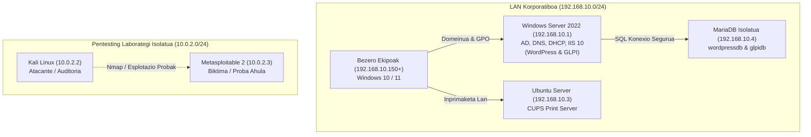

# ⚡ TEAM-DOC

> **Azpiegitura Teknologikoaren, Sistemen Administrazioaren eta Segurtasunaren Dokumentazio Zentralizatua.**

.md)
.md)

---

## 📖 Aurkibidea / Dokumentazio Moduluak

Proiektu honek enpresa-azpiegitura oso baten hedapena, konfigurazioa eta auditoria jasotzen ditu:

| Modulua | Deskribapena | Fitxategia |
|:---|:---|:---|
| 🖥️ **Sistemak (SEA)** | Active Directory (`sty.eus`), GPO politikak, CUPS inprimaketa-zerbitzaria | [Ikusi SEA](docs/Sistemas%20Eragileak%20Administratzea%20(SEA).md) |
| 🌐 **WordPress (WAE)** | IIS 10 web zerbitzaria + MariaDB urruneko datu-base segurua | [Ikusi WordPress](docs/WAE/Wordpress.md) |
| 🎫 **GLPI 10 (WAE)** | IT baliabideen inbentario automatikoa eta intzidentzia-txartelak | [Ikusi GLPI](docs/WAE/GLPI.md) |
| ⚔️ **Pentesting & HACK** | Kali Linux vs Metasploitable 2 laborategia, Nmap eskaneatzea | [Ikusi HACK](docs/Hackin%20Documentacion.md) |
| 🛡️ **Segurtasuna** | Informazioaren segurtasun-plana, baimenak eta babes-neurriak | [Ikusi Segurtasuna](docs/Segurtasuna%20documentacion.md) |
| ⚙️ **Hardwarea** | ServerToYou ekipoen fitxa teknikoak eta inbentario orokorra | [Ikusi Hardware](docs/Hardware.md) |
| 🌱 **Jasangarritasuna** | ESG irizpideak, energia-eraginkortasuna eta birziklapena | [Ikusi Jasangarritasuna](docs/06-jasangarritasuna.md) |

---

## 🗺️ Sare eta Zerbitzarien Arkitektura

---

## 🚀 GitHub Pages Bidezko Bistarapena

Dokumentazio hau webgune interaktibo gisa ikus daiteke GitHub Pages aktibatuta (`docs/` karpeta erabiliz):

1. Git biltegiko **Settings** > **Pages** atalera joan.
2. **Build and deployment** atalean:
   - Source: `Deploy from a branch`
   - Branch: `main` (edo erabilitako adarra), `/docs` karpeta aukeratuta.
3. Gorde eta minutu gutxitan zure webgune korporatiboa prest egongo da estilo modernoarekin!
